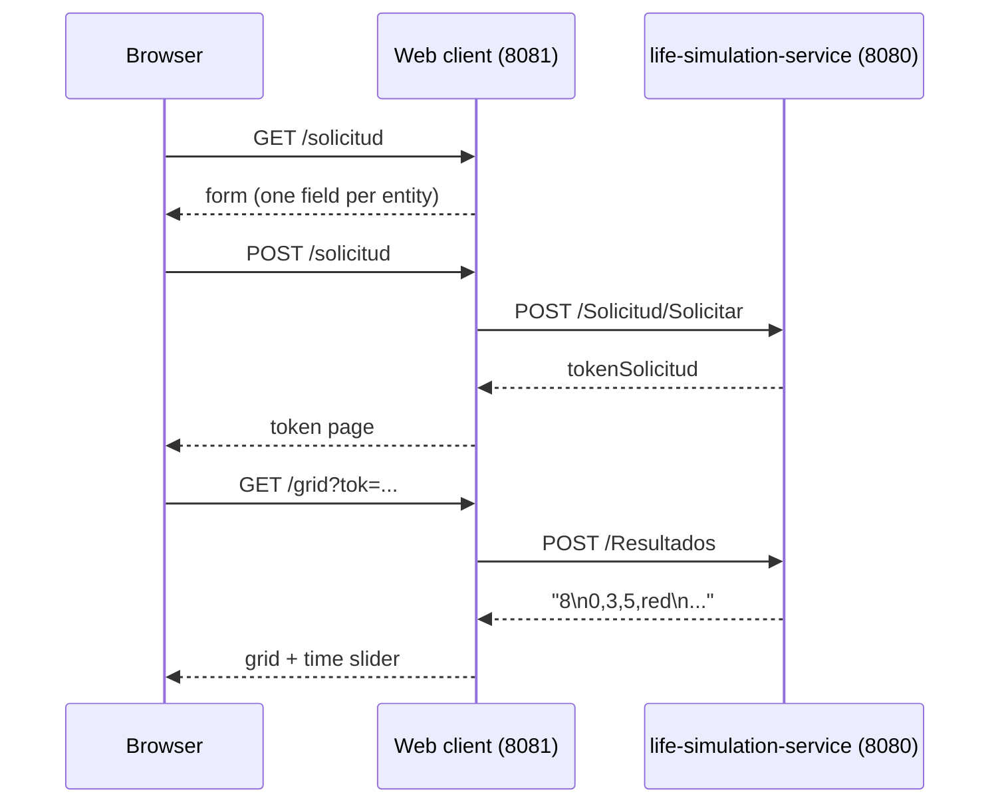

<p align="center"></p>

<p align="center">A Spring Boot + Thymeleaf web client for the life simulation service: request a simulation from a form and replay its evolution step by step on a colour grid.</p>

<p align="center">
  
  <a href="LICENSE"></a>
  <a href="https://santiagodie.com/life-simulation-web-client/"></a>
</p>

## Table of Contents

- [About the Project](#about-the-project)
- [Live Demo](#live-demo)
- [Features](#features)
- [Built With](#built-with)
- [How It Works](#how-it-works)
- [Getting Started](#getting-started)
- [Tests](#tests)
- [Project Structure](#project-structure)
- [Known Limitations](#known-limitations)
- [License](#license)
- [Contact](#contact)

## About the Project

The web client is the front end of a two-part project. It asks the user how many individuals of each species should take part, sends the request to **[life-simulation-service](https://github.com/santiagodie/life-simulation-service)** through a REST client generated from the service's OpenAPI contract, and shows the token the service returns. With that token, the grid page downloads the result and replays the simulation on an N×N grid with a time slider.

The controllers, views and domain model come from a course template. The service client (generated with OpenAPI Generator), the simulation and email services, the parsing of results, the configuration, the tests and the design of the three views were added on top of it.

## Live Demo

**[santiagodie.com/life-simulation-web-client](https://santiagodie.com/life-simulation-web-client/)**: a static version of the three screens, built from the same Thymeleaf templates and styles (UI in Spanish, as in the original project). The request form, the token page and the grid with its time slider work as in the app; the controllers' logic runs in the browser and simulations are generated by a JavaScript port of the service's simulation code (standard mode). Simulations recorded from the real service are also available. Email sending is disabled in the demo.

To run the real client against the real service, see [Getting Started](#getting-started).

## Features

- **Simulation request form** for three entity types, with validation of every field (integer, non-negative, known entity).
- **Service client** generated with OpenAPI Generator (`RestTemplate`): `POST /Solicitud/Solicitar` to request a simulation and `POST /Resultados` to download it.
- **Result parsing**: the service's text format (`time,row,column,colour` per line) is turned into points grouped by time step.
- **Grid view**: an N×N grid sized from the service's response, coloured by species, with a slider over the time steps (0 to 10); empty cells are grey and the grid shrinks to fit phone screens.
- **Email service** interface for notifying recipients (it only logs the message; see [Known Limitations](#known-limitations)).

## Built With

- Java 17, Spring Boot 4.0 (Web MVC, RestClient), Thymeleaf
- OpenAPI Generator (Java `RestTemplate` client)
- JUnit 5, Mockito
- Maven (wrapper included), Docker and Docker Compose

## How It Works



`SolicitudController` validates the form and calls `ContactoSimService`, which builds the request body and sends it to the service. `GridController` asks `ContactoSimService` for the result of a token, which parses the text into a `DatosSimulation` (grid width, number of steps and points per step); the controller turns it into a map of `step-row-column → colour` that the Thymeleaf template renders with a few lines of JavaScript.

## Getting Started

### Prerequisites

- JDK 17 or later (the Maven Wrapper downloads Maven)
- [life-simulation-service](https://github.com/santiagodie/life-simulation-service) running on `http://localhost:8080`, for example with its `docker compose up --build`

### Run locally

```bash
git clone https://github.com/santiagodie/life-simulation-web-client.git
cd life-simulation-web-client
./mvnw spring-boot:run
```

Open `http://localhost:8081/solicitud`, submit the form and then open `http://localhost:8081/grid?tok=<token>` with the token shown.

The service URL is set in `application.properties` (`servicio.url`) and can be overridden with the `SERVICIO_URL` environment variable.

### Run with Docker

With the service already running on the host:

```bash
docker compose up --build
```

The image builds the project with Maven and runs it on Java 21, so no local build is needed.

The container reaches the service through `host.docker.internal:8080`; set `SERVICIO_URL` to use another address.

## Tests

```bash
./mvnw test
```

Unit tests cover `ContactoSimService` (request body, token handling and result parsing, with mocked `RestTemplate` and `ResultadosApi`), `EnviarEmailsService` and the generated service client.

## Project Structure

```
src/main/java/
├── com/tt1/trabajo/
│   ├── TrabajoApplication.java      # Spring Boot entry point
│   ├── SolicitudController.java     # GET/POST /solicitud: form and validation
│   ├── GridController.java          # GET /grid?tok=: grid view model
│   └── utilidades/                  # OpenAPI-generated client for the service (APIs, auth, models)
├── interfaces/                      # InterfazContactoSim, InterfazEnviarEmails
├── modelo/                          # DatosSimulation, DatosSolicitud, Destinatario, Entidad, Punto
└── servicios/                       # ContactoSimService, EnviarEmailsService, LoggerConfig
src/main/resources/
├── application.properties           # Port 8081 and service URL
└── templates/                       # solicitud.html, formResult.html, grid.html
src/test/java/                       # Unit tests
demo/                                # Static demo for GitHub Pages, built from the templates by build-site.js
Dockerfile                           # Multi-stage build: Maven package, then eclipse-temurin:21-jre
docker-compose.yml                   # Web client container pointing at the service on the host
```

## Known Limitations

- Email sending is not implemented: `EnviarEmailsService` only logs the message, and there is no screen for it.
- The entity types (servers, clients and databases) are fixed in `ContactoSimService`.
- The form page does not show validation errors: when a field is invalid, the result page appears without a token.

## License

Released under the [GNU General Public License v3.0](LICENSE), the licence of the course template this project is based on.

## Contact

Santiago Die · [GitHub](https://github.com/santiagodie) · [LinkedIn](https://www.linkedin.com/in/santiago-die-morejon)

---

Built for the Cross-disciplinary Workshop I: Programming and Information Processing course at the University of La Rioja (2025–26).
